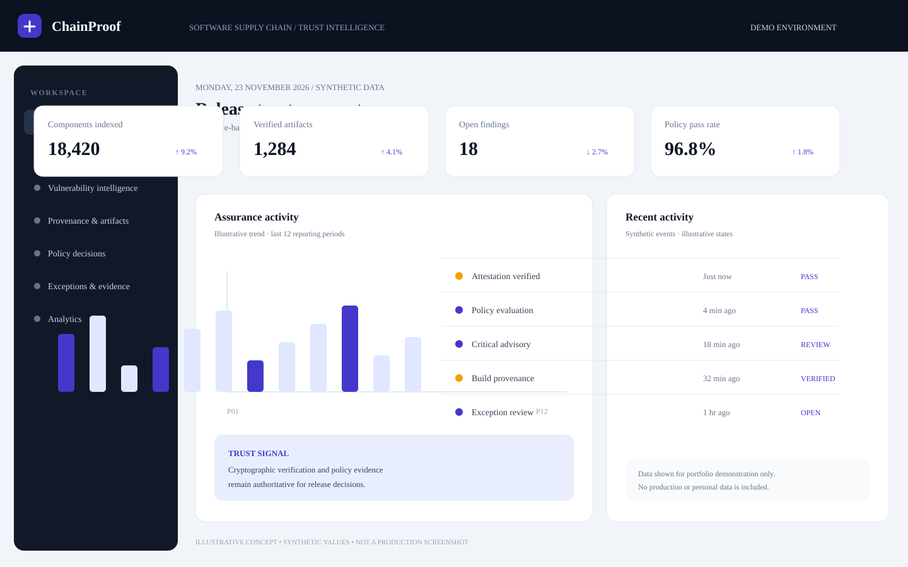
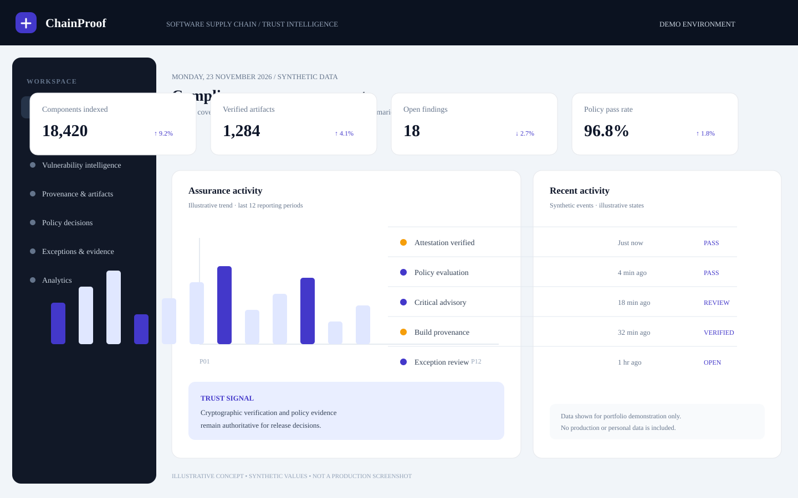

# ChainProof

**Enterprise Software Supply Chain Security & Trust Intelligence Platform**

> Build explainable release confidence from software inventory, provenance evidence and policy-driven security signals.

[](https://github.com/matiur25580/Enterprise-Software-Supply-Chain-Security-Trust-Intelligence-Platform/actions/workflows/ci.yml)
[](https://github.com/matiur25580/Enterprise-Software-Supply-Chain-Security-Trust-Intelligence-Platform/actions/workflows/codeql.yml)
[](https://nodejs.org/)
[](https://www.typescriptlang.org/)
[](https://www.docker.com/)

---

## 1. Executive overview

ChainProof is a security engineering portfolio project exploring how organizations can make software supply-chain risk more visible, attributable and actionable. Its product direction brings together SBOM inventory, artifact integrity, build provenance, vulnerability context and policy-based release assurance.

The current runnable milestone provides tenant-aware authentication, SBOM metadata inventory, bounded CycloneDX/SPDX JSON document ingestion and normalization, on-demand OSV vulnerability lookup with persisted scan history and CVSS/CISA KEV/FIRST EPSS context, digest uniqueness controls, search/filter/export, health checks and a React dashboard. It queries OSV and enriches CVE aliases with optional CISA KEV/FIRST EPSS context; it verifies Cosign/Sigstore artifact signatures and signed SLSA provenance under explicit server-side identity policies. It does **not** make automated production release decisions or claim full SLSA conformance.

**Project status:** active engineering foundation / demonstrable MVP. The screenshots in this README are illustrative dashboard concepts made with synthetic data; they are not captures of a live production system.

## 2. The problem

Modern software is assembled from direct and transitive dependencies, external build systems, package registries and third-party services. Security teams need answers to practical questions:

- What components and versions are present in a release?
- Which artifact and source revision produced a deployed binary?
- Can the build identity and provenance be verified?
- Which vulnerabilities are exploitable in the actual deployment context?
- Which policy controls passed, failed or require an accountable exception?
- Can the evidence behind a release decision be reproduced during an audit?

ChainProof is designed around evidence-backed answers rather than opaque risk scores.

## 3. Product capabilities and implementation status

### Available in this branch

- **Tenant-aware identity:** JWT authentication, role-based authorization and tenant-scoped records.
- **SBOM document ingestion:** accept bounded CycloneDX 1.4–1.6 and SPDX 2.3 JSON documents, validate required structure, normalize package names/versions/types and package URLs, and persist a tenant-scoped component summary.
- **SBOM metadata inventory:** record format metadata, document version, component count, source and a server-computed SHA-256 digest of the JSON serialization.
- **Inventory discovery:** search by document name and filter by SBOM format.
- **Controlled export:** tenant-scoped CSV export with quoting and spreadsheet-formula injection protection.
- **Integrity metadata:** duplicate SHA-256 digest prevention within a tenant.
- **Vulnerability intelligence:** on-demand OSV batch lookup for up to 100 unique package URLs; persist tenant-scoped scan snapshots with CVSS/severity metadata and optional CISA KEV/FIRST EPSS enrichment for CVE aliases.
- **Scan history:** retrieve the latest 20 vulnerability scan snapshots for a tenant-owned SBOM.
- **Cosign artifact signature verification:** verify a Sigstore/Cosign detached signature bundle against the exact supplied artifact bytes and server-configured certificate issuer/identity.
- **SLSA provenance verification:** verify a signed in-toto SLSA provenance v1 DSSE bundle, match its subject SHA-256 digest to the artifact bytes, and enforce an explicit builder allowlist.
- **Trust audit history:** persist successful and rejected verification outcomes with artifact digest, signer policy, builder identity and source revision metadata; submitted artifact and bundle bytes are not retained.
- **Deterministic release policy:** evaluate tenant-owned SBOM scan evidence and a matching verified SLSA provenance record using versioned rules; persist pass/warn/block outcomes with check-level evidence.
- **Abuse controls:** bounded request payloads and rate-limited intake/login endpoints.
- **Operational health:** API health and database-aware readiness endpoints.
- **Container foundation:** multi-stage Docker build, non-root runtime and Compose-managed MongoDB.
- **Engineering controls:** automated tests, type checks, production builds, container image build, CodeQL workflow and Dependabot configuration.
- **Database index provisioning:** explicit idempotent index command for deployment workflows.

### Product roadmap — not represented as shipped functionality

- Full upstream CycloneDX/SPDX JSON Schema validation, relationship/graph preservation and robust package identity reconciliation.
- Package URL (purl) identity resolution and component relationship graphs.
- NVD enrichment, deployment-aware exploitability context and policy-based prioritization of persisted findings.
- OCI image signature verification and registry-aware Cosign verification.
- Full SLSA build-level policy evaluation, source-control protections and deployment-aware release gates.
- Configurable policy authoring, approval workflows, risk exceptions and signed release attestations.
- Risk exceptions with owners, expiry, compensating controls and approval history.
- Evidence retention, audit export, alerting and integrations with GitHub and CI/CD systems.

Roadmap items are clearly separated from the current MVP so that portfolio reviewers can distinguish implemented behavior from product ambition.

## 4. Architecture

```text
React + TypeScript dashboard
          |
          | HTTPS / JSON + Bearer JWT
          v
Express + TypeScript API
  |       |        |
  |       |        +-- Zod request validation
  |       +----------- Authentication / RBAC
  +------------------- Tenant-scoped services
          |
          v
       MongoDB
  users / SBOMs / vulnerability scans / trust audit / policy evaluations / signed release passports
```

### Technology stack

| Layer | Technology |
|---|---|
| Web | React 18, TypeScript, Vite |
| API | Node.js, Express 4, TypeScript |
| Validation | Zod |
| Persistence | MongoDB, Mongoose |
| Identity | bcrypt password hashing, short-lived JWT |
| Security middleware | Helmet, CORS allowlist, express-rate-limit |
| Testing | Vitest, Supertest, Testing Library |
| Delivery | GitHub Actions, CodeQL, Dependabot, Docker Compose |

## 5. Security and trust model

- Tenant ownership is derived from the authenticated identity; client-supplied tenant IDs are not accepted on SBOM writes.
- Protected routes enforce role permissions at the API boundary.
- Passwords are stored as bcrypt hashes; access tokens are short-lived and use issuer/audience validation.
- Login and SBOM intake are rate-limited; JSON request bodies have a size limit.
- CSV export quotes fields and neutralizes spreadsheet formula prefixes.
- Document ingestion accepts JSON request bodies up to the API's 2 MiB limit; the server computes a digest from the parsed JSON serialization. It is not a byte-for-byte original upload hash and does not establish artifact authenticity.
- The parser validates CycloneDX 1.4/1.5/1.6 and SPDX 2.3 JSON against vendored upstream JSON Schemas, then applies bounded normalization and retains component identifiers plus dependency/relationship edges. The raw SBOM document is not retained. The SHA-256 digest is calculated from canonical JSON serialization, not the original upload bytes.
- Sigstore verification uses server-configured certificate issuer and exact certificate identity; SLSA builder IDs must match a server-side allowlist. Requests cannot weaken or replace these trust policies.
- Artifact verification accepts at most 1 MiB of base64-encoded artifact bytes and a bounded Sigstore bundle. It computes SHA-256 over the supplied bytes and checks the signed SLSA statement subject against that digest.
- Verification stores the artifact digest and result metadata only; it does not persist artifact bytes or the submitted Sigstore bundle. Rejected attempts are also recorded with a stable failure code.
- Uploaded artifacts, repositories and build scripts must never be executed inside the API process.
- Secrets belong in a secret manager or local ignored environment file, never in source control.

### Database indexes

Production automatic index creation is disabled. Run the explicit index provisioning command as a controlled deployment/migration step using an environment with database access and index-creation privileges:

```bash
MONGODB_URI='mongodb://127.0.0.1:27017/chainproof' npm run db:indexes
```

The command provisions declared user, SBOM, vulnerability scan, artifact verification and policy evaluation indexes and exits non-zero if provisioning fails. Review index changes and database permissions before production rollout.

## 6. Quick start

### Prerequisites

- Node.js 20 or newer and npm
- Docker Engine + Docker Compose (recommended for the complete local stack)
- A local MongoDB instance if not using Compose
- `jq` and GNU `base64` for the optional shell/API examples

### Option A — Docker Compose

Create a local-only secret and start the application:

```bash
printf 'JWT_SECRET=%s\n' "$(openssl rand -base64 48)" > .env
docker compose up --build -d
docker compose ps
docker compose logs -f app
```

Open **http://localhost:4000**. API health is available at `/api/health`; database readiness is available at `/api/health/ready`.

Stop the containers with `docker compose down`. The named MongoDB volume is preserved; use `docker compose down -v` only when intentionally deleting local database data.

### Option B — Run from source

```bash
cp .env.example .env
# Edit .env and replace JWT_SECRET with a random value of at least 32 characters.
npm install
npm run dev
```

In a second terminal:

```bash
npm run dev:web
```

Open **http://localhost:5173**. The Vite development server proxies API requests to port 4000.

### Provision a local operator

After configuring MongoDB and the environment, create a tenant-scoped user with the operator-only CLI:

```bash
npm run user:create
```

Use the CLI prompts; do not commit credentials or share a demo password in screenshots.


### Validate an SBOM locally before upload

You can run the same official-schema validation offline without sending the SBOM to ChainProof or any external service:

```bash
# Validate a local CycloneDX 1.6, CycloneDX 1.5/1.4, or SPDX 2.3 JSON file.
npm run sbom:validate -- --file ./bom.json

# Exit codes: 0 = valid; 1 = command usage; 2 = invalid JSON, unsupported version, or schema failure.
```

The CLI prints the format/version, component count, retained dependency relationship count and canonical-JSON digest. Upstream schema source revisions and license notes are documented in [apps/api/src/schemas/sbom/README.md](apps/api/src/schemas/sbom/README.md).

### Check an SBOM against OSV

After ingesting a document, use its MongoDB record ID to request an on-demand vulnerability lookup:

```bash
curl -X POST http://localhost:4000/api/sboms/<sbom-record-id>/vulnerabilities \
  -H 'Authorization: Bearer <access-token>'
```

The endpoint checks up to 100 unique PURLs using the public OSV batch API. It only sends package URLs—not raw SBOM documents, tenant identifiers or source repository metadata. Each successful scan is persisted as a tenant-scoped snapshot; the latest 20 are available from `GET /api/sboms/<sbom-record-id>/vulnerability-scans`. CVSS vector/severity data is retained when OSV supplies it. CVE aliases are optionally enriched from CISA KEV and FIRST EPSS; enrichment failure does not invalidate the OSV scan, and missing values remain unknown. Requests are tenant-scoped and rate-limited; an SBOM with no PURLs returns an empty result. OSV availability is an external dependency, and upstream errors are surfaced rather than represented as a clean scan.

### Ingest a CycloneDX or SPDX JSON document

Authenticate first and send the JSON document to `POST /api/sboms/document`. The endpoint is tenant-scoped, rate-limited and limited by the API's 2 MiB JSON body parser. Example CycloneDX request:

```bash
curl -X POST http://localhost:4000/api/sboms/document \
  -H 'Authorization: Bearer <access-token>' \
  -H 'Content-Type: application/json' \
  --data-binary @request.json
```

The endpoint expects an envelope: `{"document": { ...SBOM JSON... }, "source": "optional-origin"}`. It validates CycloneDX 1.4, 1.5 and 1.6, plus SPDX 2.3 JSON against the upstream JSON Schemas vendored under `apps/api/src/schemas/sbom/`. Successful ingestion stores a server-computed JSON-serialization digest, normalized component identifiers and dependency/relationship edges; it does not store the raw document. Invalid structures return HTTP 400 and a tenant-local duplicate digest returns HTTP 409.


### Verify signed SLSA provenance

The API provides two verification endpoints: detached Cosign/Sigstore blob signature verification and signed SLSA provenance verification. Both validate the bundle against the actual supplied artifact bytes and the configured signer certificate identity/issuer. The provenance endpoint additionally verifies a Sigstore DSSE bundle containing an in-toto Statement v1 with the SLSA provenance v1 predicate. The signed statement must name the supplied artifact's SHA-256 digest as a subject, and its builder ID must be in the server's explicit allowlist.

Configure these values in the deployment secret/environment configuration before enabling the endpoint:

- `SIGSTORE_CERTIFICATE_ISSUER`: expected OIDC issuer (for example, GitHub Actions).
- `SIGSTORE_CERTIFICATE_IDENTITY`: exact certificate identity expected to sign the bundle (for example, the approved workflow identity).
- `SLSA_ALLOWED_BUILDERS`: comma-separated exact builder IDs allowed by this deployment. Keep this list narrow and review changes.

If any policy setting is missing, verification fails closed with HTTP 503. Signature/policy/provenance failures return HTTP 422 and create a tenant-scoped rejected audit record. Successful verification returns HTTP 200 and creates a verified record.

Example detached artifact signature request (bundle created with `cosign sign-blob --bundle signature.sigstore.json release.tar.gz`):

```bash
jq -n --arg artifactBase64 "$(base64 -w0 release.tar.gz)" \
  --slurpfile bundle signature.sigstore.json \
  '{artifactBase64: $artifactBase64, bundle: $bundle[0]}' \
  | curl -X POST http://localhost:4000/api/trust/verify-artifact-signature \
      -H 'Authorization: Bearer <access-token>' \
      -H 'Content-Type: application/json' --data-binary @-
```

Example SLSA provenance request (the bundle file must be a Sigstore DSSE attestation bundle, not a plain detached signature):

```bash
jq -n --arg artifactBase64 "$(base64 -w0 release.tar.gz)" \
  --slurpfile bundle provenance.sigstore.json \
  '{artifactBase64: $artifactBase64, bundle: $bundle[0]}' \
  | curl -X POST http://localhost:4000/api/trust/verify-slsa-provenance \
      -H 'Authorization: Bearer <access-token>' \
      -H 'Content-Type: application/json' --data-binary @-
```

The latest verification audit records from both endpoints are available from `GET /api/trust/verifications`; results are always scoped to the authenticated tenant. The service does not store artifact bytes or the submitted bundle. The verifier checks the Sigstore certificate identity/issuer policy and signed SLSA subject digest; it does not enforce every SLSA build requirement. The separate deterministic release policy endpoint combines persisted vulnerability scan evidence with a matching verified SLSA record and returns an auditable pass/warn/block result; it is a starter policy, not a complete enterprise release-control framework.

### Evaluate release readiness with the deterministic policy engine

The policy engine is deliberately separate from cryptographic verification: Sigstore establishes whether the artifact's signed provenance is trusted; the policy engine decides whether the available security evidence meets the current release rules.

**Policy version:** `chainproof-release-v1`

| Rule | Result |
|---|---|
| No completed vulnerability scan | Block |
| No verified SLSA provenance for the exact artifact SHA-256 | Block |
| CISA KEV-listed vulnerability | Block |
| CVSS >= 9.0 | Block |
| EPSS >= 0.80 | Block |
| CVSS >= 7.0 or EPSS >= 0.50 | Warn |
| Scan older than 30 days | Warn |
| Recent scan, no blocking/warning findings and matching provenance | Pass |

The risk score is a transparent maximum-severity indicator (0–100), not a probability. Every evaluation stores the policy version, artifact digest, individual checks and evidence in a tenant-scoped audit record. A pass is only a result under this starter policy; it is not a claim of regulatory compliance or proof that all production release risks are covered.

**API request:**

```bash
curl -X POST http://localhost:4000/api/policy/evaluate-release \
  -H 'Authorization: Bearer <access-token>' \
  -H 'Content-Type: application/json' \
  -d '{"sbomId":"<24-character-sbom-id>","artifactDigest":"<64-character-artifact-sha256>"}'
```

**Command-line workflow:** export a short-lived API token into the environment (do not put it in shell history or command arguments), then evaluate:

```bash
export CHAINPROOF_API_URL='http://localhost:4000'
export CHAINPROOF_TOKEN='<access-token>'
npm run policy:evaluate -- --sbom-id '<24-character-sbom-id>' --artifact-sha256 '<64-character-artifact-sha256>'
```

The CLI prints the full JSON decision. Exit codes: `0` for pass/warn or a successful API response, `1` for input/network/API errors, and `2` when the policy outcome is block. The audit history is available from `GET /api/policy/evaluations` and is restricted to the authenticated tenant.

### Issue and verify a signed Release Trust Passport

A Release Trust Passport is a portable evidence envelope that binds one artifact SHA-256 digest to the selected SBOM, latest available OSV scan snapshot, matching verified SLSA provenance (when present), and a versioned release-policy evaluation. It is signed with an Ed25519 private key. The API persists only the evidence metadata and signature—not artifact bytes or the original SBOM.

**Configure a persistent signing key** (keep it outside Git and store it in a production secret manager):

```bash
openssl genpkey -algorithm ED25519 -out release-passport-private.pem
chmod 600 release-passport-private.pem
export RELEASE_PASSPORT_PRIVATE_KEY="$(cat release-passport-private.pem)"
```

For Docker Compose, export the same variable before `docker compose up`. If the signing key is absent, passport issuance returns `503`; existing passports remain independently verifiable because each envelope carries its public key and SHA-256 key fingerprint. Treat that fingerprint as a trust anchor and distribute it through a trusted channel. The embedded public key proves integrity, not organizational identity by itself.

**Issue a passport** after evaluating release policy:

```bash
curl -X POST http://localhost:4000/api/policy/release-passports \
  -H 'Authorization: Bearer <access-token>' \
  -H 'Content-Type: application/json' \
  -d '{"evaluationId":"<24-character-policy-evaluation-id>"}'
```

**List and retrieve passports** (all results are tenant-scoped):

```bash
curl http://localhost:4000/api/policy/release-passports \
  -H 'Authorization: Bearer <access-token>'
curl http://localhost:4000/api/policy/release-passports/<passport-uuid> \
  -H 'Authorization: Bearer <access-token>'
```

The retrieval endpoint verifies the Ed25519 signature and public-key fingerprint before returning `signatureValid`. A passport may document a `block` decision too; issuance is an evidence-recording operation, not a release authorization.

**Offline verification:** save the API response as `release-passport.json`, then run:

```bash
npm run passport:verify -- --file ./release-passport.json
```

Exit codes: `0` valid signature, `1` input/file error, `2` invalid signature or tampered payload. The verifier is offline and checks integrity/fingerprint consistency; consumers must separately trust the published key fingerprint and review the policy version and evidence semantics.

## 7. Environment configuration

| Variable | Purpose | Example / requirement |
|---|---|---|
| `MONGODB_URI` | MongoDB connection string | Local URI in `.env.example`; production URI from secret manager |
| `PORT` | API listen port | `4000` |
| `HOST` | API bind interface | `0.0.0.0` in containers |
| `CORS_ORIGIN` | Allowed browser origin(s) | `http://localhost:5173` |
| `NODE_ENV` | Runtime mode | `development` or `production` |
| `JWT_SECRET` | JWT signing secret | Random secret, minimum 32 characters |\n| `SIGSTORE_CERTIFICATE_ISSUER` | Required OIDC issuer for keyless verification | Exact issuer URL |\n| `SIGSTORE_CERTIFICATE_IDENTITY` | Required signer certificate identity | Exact workflow or signer identity |\n| `SLSA_ALLOWED_BUILDERS` | Allowed SLSA builder IDs | Comma-separated exact builder IDs |\n| `RELEASE_PASSPORT_PRIVATE_KEY` | Ed25519 PKCS#8 PEM signing key | Store in a secret manager; never commit it |

Never use the example JWT value outside local setup. Production should use managed secrets, TLS, authenticated MongoDB, network restrictions, backups and monitored operations.

## 8. Run quality checks

```bash
npm test
MONGODB_URI=mongodb://127.0.0.1:27017/chainproof_test npm run test:integration
npm run policy:evaluate -- --sbom-id '<24-character-sbom-id>' --artifact-sha256 '<64-character-artifact-sha256>'
npm run typecheck
npm run build
npm run db:indexes
```

The CI workflow runs tests, API/web type checks, production builds and a Docker image build. CodeQL runs on pushes, pull requests and a weekly schedule. Dependabot checks npm and GitHub Actions dependencies weekly.

**Verification boundary:** the CI pipeline runs both mocked unit/API tests and MongoDB-backed integration tests against an ephemeral MongoDB 7 service. This verifies the tested persistence and tenant-isolation paths, but does not prove browser end-to-end behavior, vulnerability-feed accuracy or production deployment readiness.

## 9. Dashboard concept gallery — 12 illustrative screens

The following twelve images are **illustrative UI concepts** created for product storytelling and design direction. They use synthetic sample values and are arranged in a single vertical column for easy review. They are not screenshots from a live production deployment and do not imply that every depicted module is implemented.

### 01 — Supply chain command center
A concise executive view of component exposure, SBOM coverage and release assurance signals. The intended landing page helps engineering leaders understand where attention is needed without hiding the underlying evidence.


### 02 — SBOM inventory explorer
A searchable inventory concept for CycloneDX and SPDX documents, versions, component counts and provenance references. The MVP accepts bounded JSON SBOM documents and stores normalized component summaries, with search, filtering and CSV export. It does not retain raw files or preserve the complete dependency graph.


### 03 — Vulnerability intelligence
A future triage workspace for advisory severity, exploitability, affected dependency paths and remediation ownership. A mature implementation should enrich findings with trusted sources and deployment context rather than rank solely by CVSS.


### 04 — Build provenance verification
A proposed verification view for artifact digests, builder identity, signed attestations and source-to-binary traceability. The MVP verifies detached Cosign/Sigstore signatures and signed SLSA provenance v1 bundles against supplied artifact bytes and configured signer/builder policies. Full SLSA conformance and registry-aware OCI verification remain roadmap work.


### 05 — Release trust passport
A release-level evidence summary that brings together inventory, provenance, vulnerability context and policy outcomes. Its purpose is to make release readiness reviewable and reproducible.



### 06 — Policy-as-code workbench
A concept for versioned security controls, evaluation history and explainable pass/warn/block decisions. Future policy results should retain the policy version and evidence references used at evaluation time.


### 07 — Dependency risk graph
A dependency relationship view to highlight transitive exposure, critical packages and ownership gaps. A production graph should preserve package identity and source provenance across ecosystems.


### 08 — Supplier risk workspace
A governance view for supplier criticality, component ownership, exception status and remediation commitments. It is designed to connect technical findings with procurement and third-party risk processes.


### 09 — Artifact integrity monitor
A proposed monitor for digest changes, signature verification outcomes and artifact lineage. In the current milestone, digest values are recorded as metadata and are not checked against uploaded artifacts.


### 10 — Security exception governance
A controlled exception workflow with accountable approvers, expiry dates, compensating controls and review status. The design emphasizes time-bounded exceptions instead of permanent policy bypasses.


### 11 — Incident evidence timeline
A chronological workspace for correlated alerts, investigation notes, affected releases and evidence references. The goal is to make incident context traceable without treating AI-generated summaries as authoritative evidence.


### 12 — Compliance assurance report
An audit-oriented view of control coverage, evidence freshness, exceptions and release signals. Future exports should be reproducible and include source references, timestamps and policy versions.




## Signed Release Trust Passport

ChainProof can issue a portable evidence envelope for a persisted release-policy evaluation. The passport combines the tenant-owned SBOM summary, the latest available OSV scan snapshot, matching verified SLSA provenance metadata, and the exact policy decision. It is signed with Ed25519 and can be verified offline.

### Configure the signing key

Generate a dedicated Ed25519 key pair. Keep the private key in a secret manager or deployment secret; never commit it to Git or expose it to the browser.

```bash
openssl genpkey -algorithm ED25519 -out release-passport-private.pem
openssl pkey -in release-passport-private.pem -pubout -out release-passport-public.pem
# For local development only: export the PEM as a single-line value with escaped newlines.
export RELEASE_PASSPORT_PRIVATE_KEY="$(awk 'NF {sub(/\r/, ""); printf "%s\\n", $0}' release-passport-private.pem)"
```

Set `RELEASE_PASSPORT_PRIVATE_KEY` in the API runtime secret store. The API accepts only Ed25519 keys. Do not use a shared development key in production. Rotate keys using a controlled key-management process and retain the public keys needed to verify previously issued passports.

### Issue, retrieve and verify

After creating a release-policy evaluation, issue a passport with its returned `evaluationId`:

```bash
curl --fail-with-body -sS -X POST "$CHAINPROOF_API_URL/api/policy/release-passports" \
  -H "Authorization: Bearer $CHAINPROOF_TOKEN" \
  -H "Content-Type: application/json" \
  -d "{\"evaluationId\":\"$EVALUATION_ID\"}" > release-passport-response.json

jq '.passport' release-passport-response.json > release-passport.json
npm run passport:verify -- --file release-passport.json
```

The tenant-scoped API also supports:
- `GET /api/policy/release-passports?limit=20` — list recent passport metadata.
- `GET /api/policy/release-passports/{passportId}` — retrieve a passport and verify its signature server-side.

The offline verifier exits with code `0` for a valid signature, `2` for an invalid or tampered passport, and `1` for usage or file errors.

**Trust boundary:** the embedded public key and its fingerprint prove that the payload has not changed relative to that key. They do not, by themselves, establish that the signer is an organization you trust. Consumers must pin or otherwise authenticate the expected public-key fingerprint through a trusted out-of-band channel. The passport is an evidence snapshot, not a guarantee that an artifact is safe or that a release was deployed. A later scan or provenance update does not mutate an already-issued passport.

## 10. Repository map

```text
apps/
  api/                 Express API, models, middleware, routes and tests
  web/                 React dashboard and UI tests
scripts/
  create-user.ts       Operator account provisioning
  ensure-indexes.ts    Explicit database index provisioning\n  evaluate-release-policy.ts  Release policy CLI\n  verify-release-passport.ts   Offline passport signature verifier
docs/
  assets/dashboard/    12 illustrative SVG dashboard concepts
.github/
  workflows/           CI and CodeQL workflows
  dependabot.yml       Dependency update policy
Dockerfile
docker-compose.yml
```

## 11. Engineering principles and next milestones

1. Complete full official CycloneDX/SPDX schema validation, dependency graph preservation and asynchronous ingestion.
2. Add registry-aware OCI artifact retrieval and digest verification.
3. Add externally anchored passport signer trust, key rotation and revocation workflows.
4. Introduce configurable policy authoring, approval and exception workflows.
5. Add browser E2E tests and operational runbooks.
6. Add metrics, tracing, alerting, backup/restore exercises and deployment hardening.

## 12. Responsible use and disclosure

This repository is an engineering portfolio project, not a certified security product. Do not submit confidential SBOMs, private source metadata, credentials, signing keys or production artifacts to an unreviewed deployment. See [SECURITY.md](SECURITY.md) for responsible vulnerability disclosure and [CONTRIBUTING.md](CONTRIBUTING.md) for contribution expectations.

## 13. License

No open-source license is granted unless a license file is present in this repository. All rights are otherwise reserved.
