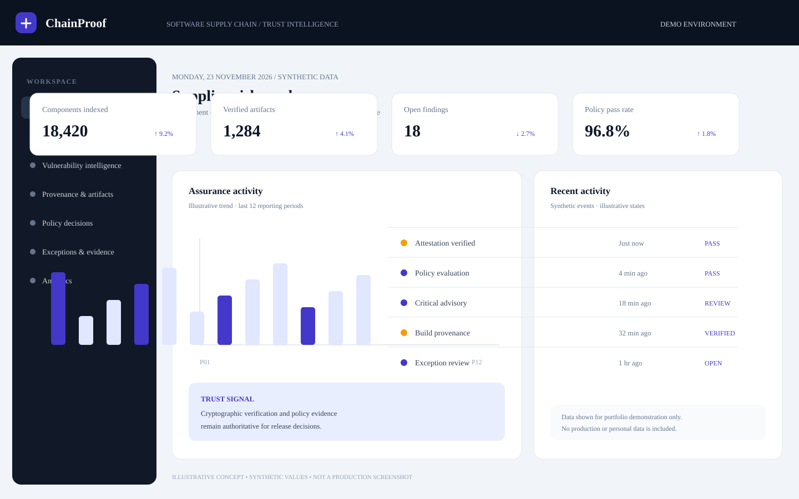

# ChainProof

**Enterprise Software Supply Chain Security & Trust Intelligence Platform**

> Build explainable release confidence from software inventory, provenance evidence and policy-driven security signals.

[](https://github.com/matiur25580/Enterprise-Software-Supply-Chain-Security-Trust-Intelligence-Platform/actions/workflows/ci.yml)
[](https://github.com/matiur25580/Enterprise-Software-Supply-Chain-Security-Trust-Intelligence-Platform/actions/workflows/codeql.yml)
[](https://nodejs.org/)
[](https://www.typescriptlang.org/)
[](https://www.docker.com/)

---

## 1. Executive overview

ChainProof is a security engineering portfolio project exploring how organizations can make software supply-chain risk more visible, attributable and actionable. Its product direction brings together SBOM inventory, artifact integrity, build provenance, vulnerability context and policy-based release assurance.

The current runnable milestone provides tenant-aware authentication, SBOM metadata inventory, bounded CycloneDX/SPDX JSON document ingestion and normalization, digest uniqueness controls, search/filter/export, health checks and a React dashboard. It does **not** yet query vulnerability feeds, verify artifact signatures or make production release decisions.

**Project status:** active engineering foundation / demonstrable MVP. The screenshots in this README are illustrative dashboard concepts made with synthetic data; they are not captures of a live production system.

## 2. The problem

Modern software is assembled from direct and transitive dependencies, external build systems, package registries and third-party services. Security teams need answers to practical questions:

- What components and versions are present in a release?
- Which artifact and source revision produced a deployed binary?
- Can the build identity and provenance be verified?
- Which vulnerabilities are exploitable in the actual deployment context?
- Which policy controls passed, failed or require an accountable exception?
- Can the evidence behind a release decision be reproduced during an audit?

ChainProof is designed around evidence-backed answers rather than opaque risk scores.

## 3. Product capabilities and implementation status

### Available in this branch

- **Tenant-aware identity:** JWT authentication, role-based authorization and tenant-scoped records.
- **SBOM document ingestion:** accept bounded CycloneDX 1.4–1.6 and SPDX 2.3 JSON documents, validate required structure, normalize package names/versions/types and package URLs, and persist a tenant-scoped component summary.
- **SBOM metadata inventory:** record format metadata, document version, component count, source and a server-computed SHA-256 digest of the JSON serialization.
- **Inventory discovery:** search by document name and filter by SBOM format.
- **Controlled export:** tenant-scoped CSV export with quoting and spreadsheet-formula injection protection.
- **Integrity metadata:** duplicate SHA-256 digest prevention within a tenant.
- **Abuse controls:** bounded request payloads and rate-limited intake/login endpoints.
- **Operational health:** API health and database-aware readiness endpoints.
- **Container foundation:** multi-stage Docker build, non-root runtime and Compose-managed MongoDB.
- **Engineering controls:** automated tests, type checks, production builds, container image build, CodeQL workflow and Dependabot configuration.
- **Database index provisioning:** explicit idempotent index command for deployment workflows.

### Product roadmap — not represented as shipped functionality

- Full upstream CycloneDX/SPDX JSON Schema validation, relationship/graph preservation and robust package identity reconciliation.
- Package URL (purl) identity resolution and component relationship graphs.
- Vulnerability enrichment using OSV/NVD and exploitability context such as EPSS/KEV.
- Artifact digest verification and Sigstore/Cosign signature validation.
- SLSA-aligned build provenance and trusted-builder policy.
- Policy-as-code with versioned controls, explainable decisions and signed release attestations.
- Risk exceptions with owners, expiry, compensating controls and approval history.
- Evidence retention, audit export, alerting and integrations with GitHub and CI/CD systems.

Roadmap items are clearly separated from the current MVP so that portfolio reviewers can distinguish implemented behavior from product ambition.

## 4. Architecture

```text
React + TypeScript dashboard
          |
          | HTTPS / JSON + Bearer JWT
          v
Express + TypeScript API
  |       |        |
  |       |        +-- Zod request validation
  |       +----------- Authentication / RBAC
  +------------------- Tenant-scoped services
          |
          v
       MongoDB
  users / SBOM metadata
```

### Technology stack

| Layer | Technology |
|---|---|
| Web | React 18, TypeScript, Vite |
| API | Node.js, Express 4, TypeScript |
| Validation | Zod |
| Persistence | MongoDB, Mongoose |
| Identity | bcrypt password hashing, short-lived JWT |
| Security middleware | Helmet, CORS allowlist, express-rate-limit |
| Testing | Vitest, Supertest, Testing Library |
| Delivery | GitHub Actions, CodeQL, Dependabot, Docker Compose |

## 5. Security and trust model

- Tenant ownership is derived from the authenticated identity; client-supplied tenant IDs are not accepted on SBOM writes.
- Protected routes enforce role permissions at the API boundary.
- Passwords are stored as bcrypt hashes; access tokens are short-lived and use issuer/audience validation.
- Login and SBOM intake are rate-limited; JSON request bodies have a size limit.
- CSV export quotes fields and neutralizes spreadsheet formula prefixes.
- Document ingestion accepts JSON request bodies up to the API's 2 MiB limit; the server computes a digest from the parsed JSON serialization. It is not a byte-for-byte original upload hash and does not establish artifact authenticity.
- The parser performs strict structural checks for supported format/version fields and normalizes a bounded component subset; it is not a complete official CycloneDX/SPDX JSON Schema validator. Raw SBOM documents are not retained.
- Uploaded artifacts, repositories and build scripts must never be executed inside the API process.
- Secrets belong in a secret manager or local ignored environment file, never in source control.

### Database indexes

Production automatic index creation is disabled. Run the explicit index provisioning command as a controlled deployment/migration step using an environment with database access and index-creation privileges:

```bash
MONGODB_URI='mongodb://127.0.0.1:27017/chainproof' npm run db:indexes
```

The command provisions declared user and SBOM indexes and exits non-zero if provisioning fails. Review index changes and database permissions before production rollout.

## 6. Quick start

### Prerequisites

- Node.js 20 or newer and npm
- Docker Engine + Docker Compose (recommended for the complete local stack)
- A local MongoDB instance if not using Compose

### Option A — Docker Compose

Create a local-only secret and start the application:

```bash
printf 'JWT_SECRET=%s\n' "$(openssl rand -base64 48)" > .env
docker compose up --build -d
docker compose ps
docker compose logs -f app
```

Open **http://localhost:4000**. API health is available at `/api/health`; database readiness is available at `/api/health/ready`.

Stop the containers with `docker compose down`. The named MongoDB volume is preserved; use `docker compose down -v` only when intentionally deleting local database data.

### Option B — Run from source

```bash
cp .env.example .env
# Edit .env and replace JWT_SECRET with a random value of at least 32 characters.
npm install
npm run dev
```

In a second terminal:

```bash
npm run dev:web
```

Open **http://localhost:5173**. The Vite development server proxies API requests to port 4000.

### Provision a local operator

After configuring MongoDB and the environment, create a tenant-scoped user with the operator-only CLI:

```bash
npm run user:create
```

Use the CLI prompts; do not commit credentials or share a demo password in screenshots.

### Ingest a CycloneDX or SPDX JSON document

Authenticate first and send the JSON document to `POST /api/sboms/document`. The endpoint is tenant-scoped, rate-limited and limited by the API's 2 MiB JSON body parser. Example CycloneDX request:

```bash
curl -X POST http://localhost:4000/api/sboms/document \
  -H 'Authorization: Bearer <access-token>' \
  -H 'Content-Type: application/json' \
  --data-binary @request.json
```

The endpoint expects an envelope: `{"document": { ...SBOM JSON... }, "source": "optional-origin"}`. It supports CycloneDX 1.4, 1.5 and 1.6, plus SPDX 2.3 JSON. Successful ingestion stores a server-computed JSON-serialization digest and normalized component summary; it does not store the raw document. Invalid structures return HTTP 400 and a tenant-local duplicate digest returns HTTP 409.

## 7. Environment configuration

| Variable | Purpose | Example / requirement |
|---|---|---|
| `MONGODB_URI` | MongoDB connection string | Local URI in `.env.example`; production URI from secret manager |
| `PORT` | API listen port | `4000` |
| `HOST` | API bind interface | `0.0.0.0` in containers |
| `CORS_ORIGIN` | Allowed browser origin(s) | `http://localhost:5173` |
| `NODE_ENV` | Runtime mode | `development` or `production` |
| `JWT_SECRET` | JWT signing secret | Random secret, minimum 32 characters |

Never use the example JWT value outside local setup. Production should use managed secrets, TLS, authenticated MongoDB, network restrictions, backups and monitored operations.

## 8. Run quality checks

```bash
npm test
MONGODB_URI=mongodb://127.0.0.1:27017/chainproof_test npm run test:integration
npm run typecheck
npm run build
npm run db:indexes
```

The CI workflow runs tests, API/web type checks, production builds and a Docker image build. CodeQL runs on pushes, pull requests and a weekly schedule. Dependabot checks npm and GitHub Actions dependencies weekly.

**Verification boundary:** the CI pipeline runs both mocked unit/API tests and MongoDB-backed integration tests against an ephemeral MongoDB 7 service. This verifies the tested persistence and tenant-isolation paths, but does not prove browser end-to-end behavior, vulnerability-feed accuracy or production deployment readiness.

## 9. Dashboard concept gallery — 12 illustrative screens

The following twelve images are **illustrative UI concepts** created for product storytelling and design direction. They use synthetic sample values and are arranged in a single vertical column for easy review. They are not screenshots from a live production deployment and do not imply that every depicted module is implemented.

### 01 — Supply chain command center
A concise executive view of component exposure, SBOM coverage and release assurance signals. The intended landing page helps engineering leaders understand where attention is needed without hiding the underlying evidence.


### 02 — SBOM inventory explorer
A searchable inventory concept for CycloneDX and SPDX documents, versions, component counts and provenance references. The MVP accepts bounded JSON SBOM documents and stores normalized component summaries, with search, filtering and CSV export. It does not retain raw files or preserve the complete dependency graph.


### 03 — Vulnerability intelligence
A future triage workspace for advisory severity, exploitability, affected dependency paths and remediation ownership. A mature implementation should enrich findings with trusted sources and deployment context rather than rank solely by CVSS.


### 04 — Build provenance verification
A proposed verification view for artifact digests, builder identity, signed attestations and source-to-binary traceability. Signature verification and provenance policy enforcement remain roadmap work.


### 05 — Release trust passport
A release-level evidence summary that brings together inventory, provenance, vulnerability context and policy outcomes. Its purpose is to make release readiness reviewable and reproducible.


### 06 — Policy-as-code workbench
A concept for versioned security controls, evaluation history and explainable pass/warn/block decisions. Future policy results should retain the policy version and evidence references used at evaluation time.


### 07 — Dependency risk graph
A dependency relationship view to highlight transitive exposure, critical packages and ownership gaps. A production graph should preserve package identity and source provenance across ecosystems.


### 08 — Supplier risk workspace
A governance view for supplier criticality, component ownership, exception status and remediation commitments. It is designed to connect technical findings with procurement and third-party risk processes.



### 09 — Artifact integrity monitor
A proposed monitor for digest changes, signature verification outcomes and artifact lineage. In the current milestone, digest values are recorded as metadata and are not checked against uploaded artifacts.


### 10 — Security exception governance
A controlled exception workflow with accountable approvers, expiry dates, compensating controls and review status. The design emphasizes time-bounded exceptions instead of permanent policy bypasses.


### 11 — Incident evidence timeline
A chronological workspace for correlated alerts, investigation notes, affected releases and evidence references. The goal is to make incident context traceable without treating AI-generated summaries as authoritative evidence.


### 12 — Compliance assurance report
An audit-oriented view of control coverage, evidence freshness, exceptions and release signals. Future exports should be reproducible and include source references, timestamps and policy versions.


## 10. Repository map

```text
apps/
  api/                 Express API, models, middleware, routes and tests
  web/                 React dashboard and UI tests
scripts/
  create-user.ts       Operator account provisioning
  ensure-indexes.ts    Explicit database index provisioning
docs/
  assets/dashboard/    12 illustrative SVG dashboard concepts
.github/
  workflows/           CI and CodeQL workflows
  dependabot.yml       Dependency update policy
Dockerfile
docker-compose.yml
```

## 11. Engineering principles and next milestones

1. Implement safe SBOM file ingestion with format-aware validation and asynchronous processing.
2. Normalize package identity with purl and preserve dependency relationships.
3. Integrate vulnerability intelligence with source attribution and freshness metadata.
4. Verify artifact signatures and provenance against configured trust roots.
5. Introduce versioned policy-as-code and auditable exception workflows.
6. Add browser E2E tests and operational runbooks.
7. Add metrics, tracing, alerting, backup/restore exercises and deployment hardening.

## 12. Responsible use and disclosure

This repository is an engineering portfolio project, not a certified security product. Do not submit confidential SBOMs, private source metadata, credentials, signing keys or production artifacts to an unreviewed deployment. See [SECURITY.md](SECURITY.md) for responsible vulnerability disclosure and [CONTRIBUTING.md](CONTRIBUTING.md) for contribution expectations.

## 13. License

No open-source license is granted unless a license file is present in this repository. All rights are otherwise reserved.
