# ChainProof

**Enterprise Software Supply Chain Security & Trust Intelligence Platform**

> Turn SBOMs, vulnerability intelligence, build provenance and policy decisions into evidence-backed release assurance.

ChainProof is a security engineering platform concept for understanding software components, verifying how artifacts were built, and applying deterministic trust gates before release.

## 1. Project status

**Main branch: foundation and architecture baseline.** Project registry, secure webhook ingress, SBOM intelligence and release provenance controls are being developed in stacked feature branches. Treat these capabilities as in progress until merged into main. A green dashboard or policy score alone does not prove a release is secure.

## 2. Product problem and value

Modern software depends on transitive open-source packages, build systems, CI identities, registries and third-party suppliers. ChainProof aims to provide an auditable workflow for SBOM ingestion, vulnerability context, build provenance, artifact/signer verification, deterministic release gates, evidence-backed Release Trust Passports and human-reviewed security explanations.

**Trust principle:** cryptographic verification and deterministic policy evaluation are authoritative. AI can summarize evidence, but cannot manufacture provenance or override a policy block.

## 3. Capability map

| Domain | Capability direction |
| --- | --- |
| Project registry | Tenant-scoped repositories, owners and criticality |
| SBOM intelligence | CycloneDX / SPDX parsing, normalization and inventory |
| Vulnerability context | CVE, OSV, KEV and exploitability correlation |
| Provenance | SLSA / in-toto attestations, digest and builder verification |
| Signing | Sigstore / Cosign identity and signature validation |
| Policy-as-code | Versioned pass / warn / block rules with explainable outcomes |
| Release Trust Passport | Evidence-linked release assurance record |
| Governance | VEX, time-bound exceptions, approvals and audit history |

## 4. Technology and architecture

The repository direction is a pnpm monorepo: React/TypeScript/Vite web, Node.js/Express/TypeScript/Zod API, MongoDB persistence, Redis/BullMQ and object storage as needed, plus GitHub, OSV, NVD, CycloneDX, SPDX and Sigstore integrations.

Security boundaries:
1. Never execute untrusted source code or artifacts inside the API process.
2. Verify artifact digests and signed attestations before trusting provenance claims.
3. Treat SBOMs, webhooks and advisory feeds as untrusted input.
4. Enforce tenant-scoped authorization for projects, artifacts and evidence.
5. Include policy versions and evidence references in release decisions.
6. Use idempotent, bounded ingestion with retry and dead-letter handling.
7. Keep secrets in a secret manager and redact them from logs.

## 5. Local development

Prerequisites: Node.js LTS, pinned pnpm version, Docker and MongoDB.

    pnpm install --frozen-lockfile
    pnpm dev
    pnpm typecheck
    pnpm test
    pnpm build

Follow package scripts and environment templates on the selected branch. Never commit access tokens, signing keys, webhook secrets or production SBOMs.

## 6. Industry standards and threat-informed roadmap

- **SLSA provenance:** align build evidence with the current specification and verify builder/source context.
- **in-toto attestations:** preserve signed statements about artifact production and supply-chain steps.
- **Sigstore / Cosign:** verify signatures and signer identity rather than trusting unsigned metadata.
- **CycloneDX and SPDX:** accept versioned SBOM formats with strict schema and resource limits.
- **VEX / KEV / EPSS:** distinguish affected, not-affected and under-investigation states; prioritize known exploited and likely exploitable findings.
- **Policy-as-code:** version controls, explain decisions and fail closed for required evidence.

References: [SLSA specification v1.2](https://slsa.dev/spec/v1.2/), [CycloneDX](https://cyclonedx.org/), [SPDX](https://spdx.dev/), [Sigstore](https://sigstore.dev/). These guide implementation; no SLSA level, certification or complete format conformance is claimed.

## 7. Security and responsible use

- Never run untrusted repository code as part of ingestion or analysis.
- Enforce strict file size, parser depth, timeout and decompression limits.
- Keep provenance claims separate from verified provenance.
- Preserve evidence digests, policy versions, actor identity and decision timestamps.
- Use synthetic project and vulnerability data in demos.
- Production requires threat modelling, key management, incident response, retention policies and independent security review.

## 8. Illustrative dashboard gallery

These 12 SVGs are **illustrative dashboard concepts**, not screenshots from a running security product. All project names, counts, vulnerabilities, attestations and policy outcomes are synthetic. The gallery is intentionally arranged in one column.

### 01. Release Trust Command Center
Executive view of release assurance, trusted builds and policy-blocked releases.

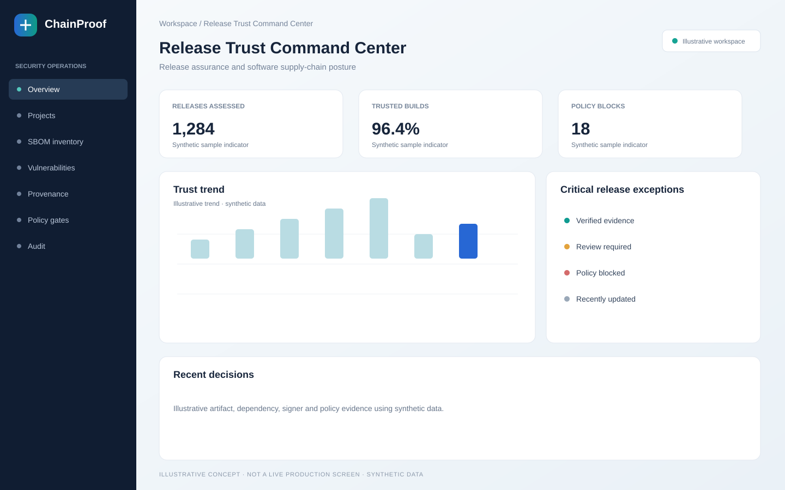

### 02. Software Component Inventory
Dependency coverage, direct/transitive packages and ownership gaps.

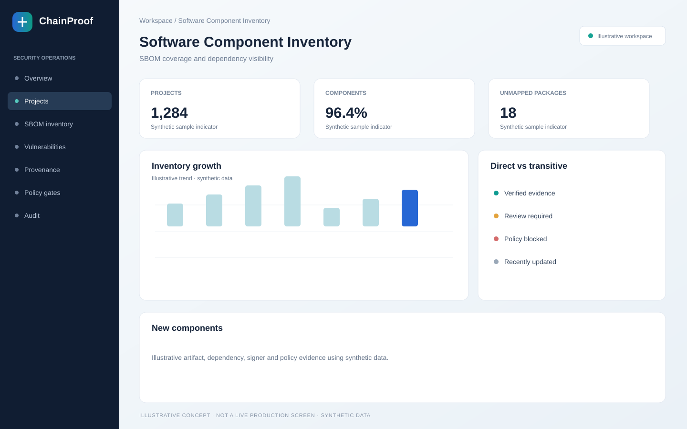

### 03. SBOM Ingestion Workbench
CycloneDX/SPDX uploads, schema validation and quarantine outcomes.

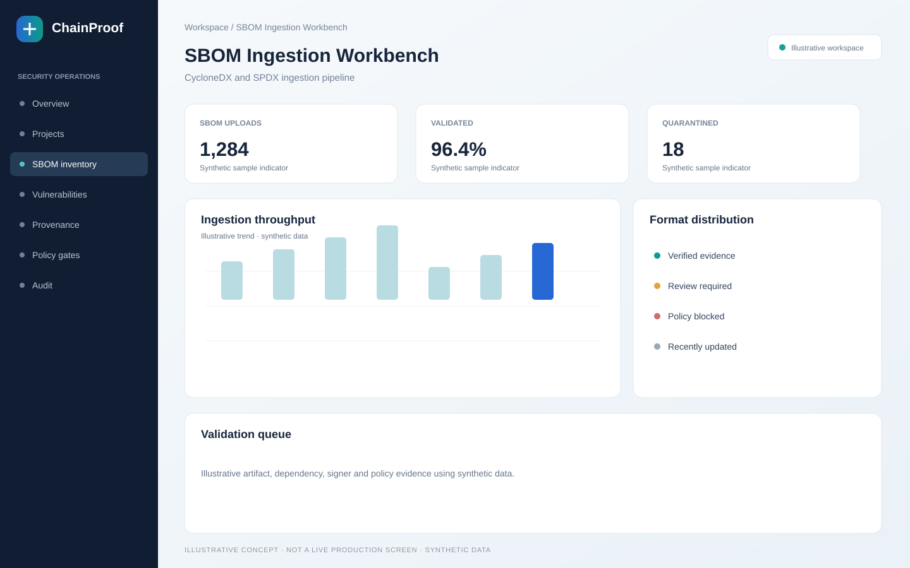

### 04. Vulnerability Intelligence
Severity, exploitability context, KEV matches and remediation backlog.

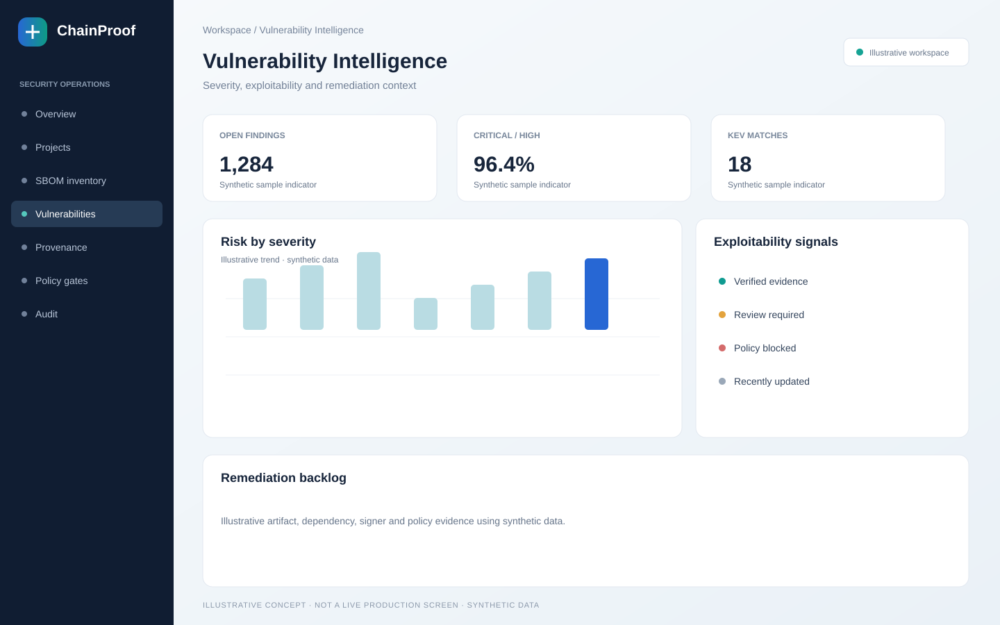

### 05. Build Provenance Verifier
Artifact digests, builder identity, provenance coverage and verification failures.

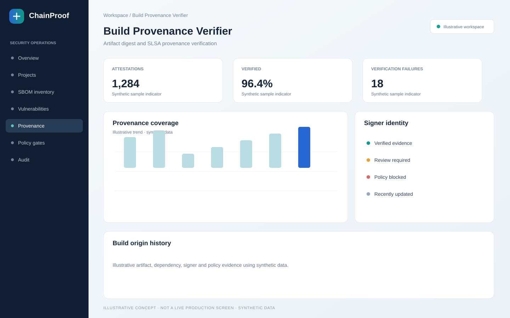

### 06. Release Trust Passport
Release-level evidence connecting artifacts, attestations, policies and approvals.

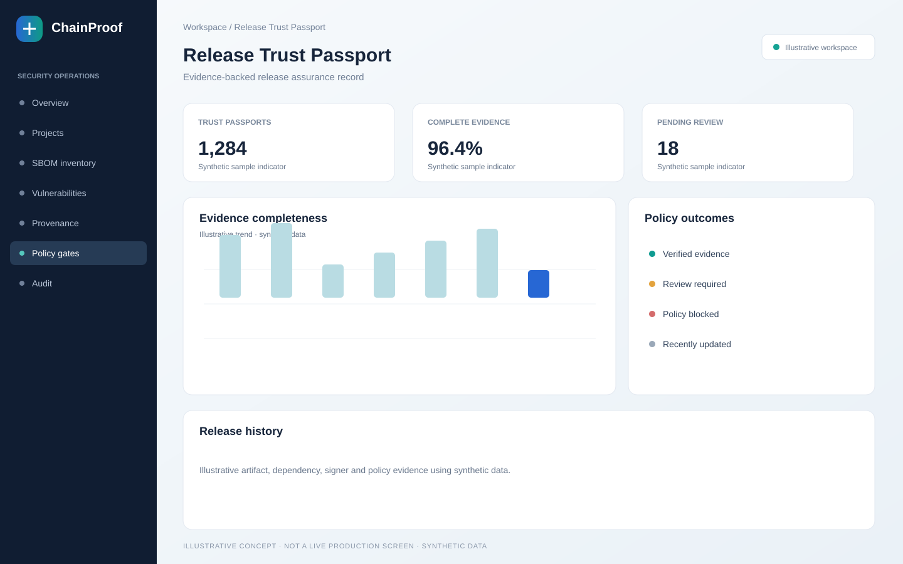

### 07. Policy-as-Code Workbench
Deterministic rules and decision traces for pass, warn and block outcomes.

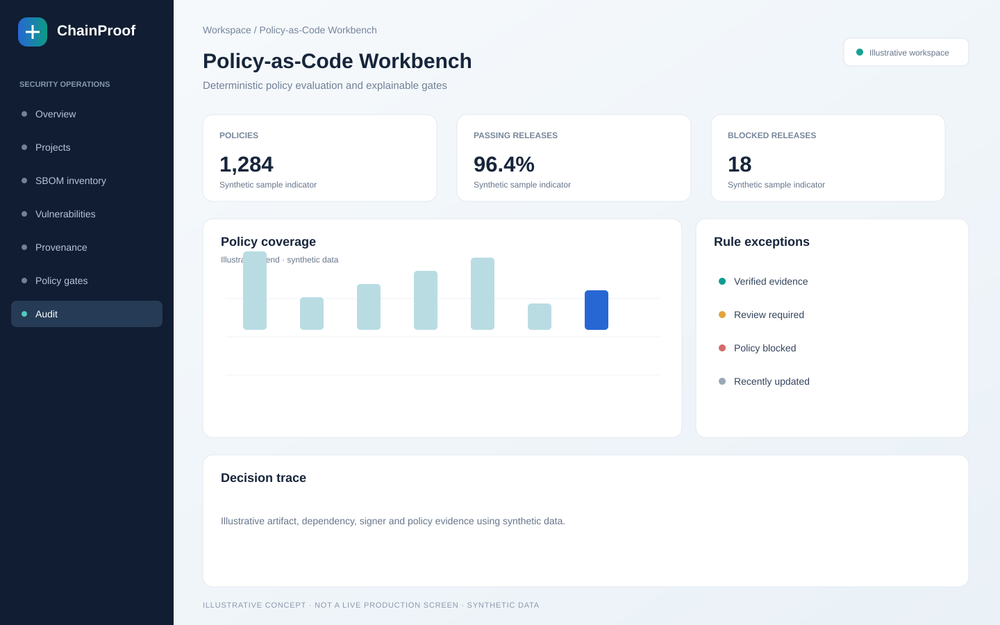

### 08. Supplier & Component Risk
Supplier exposure, critical dependencies and remediation ownership.

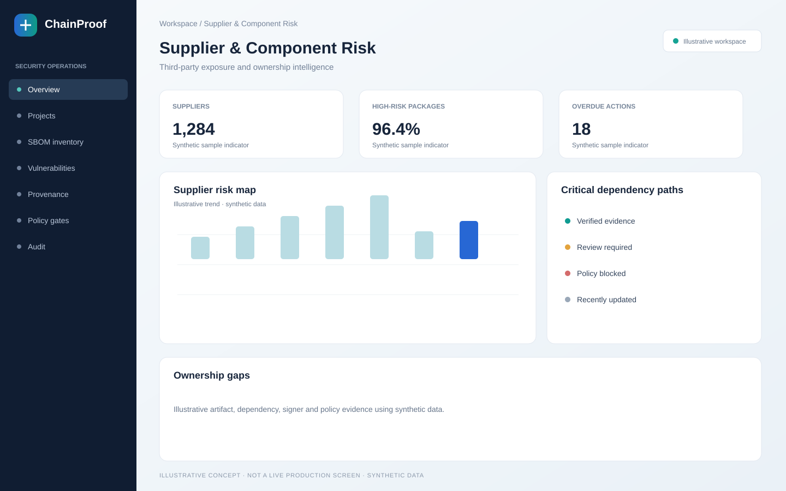

### 09. VEX & Exception Management
Exploitability statements, time-bound waivers and approvals.

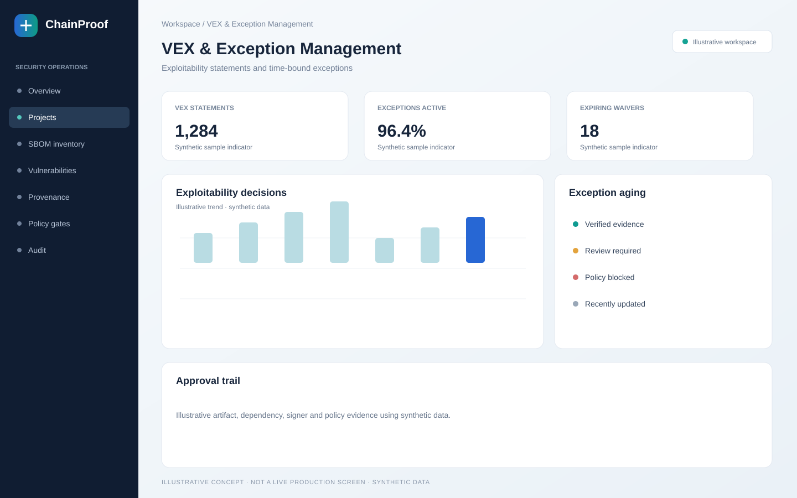

### 10. Signing & Key Governance
Signer identity, trust roots, key lifecycle, expiry and revocation signals.

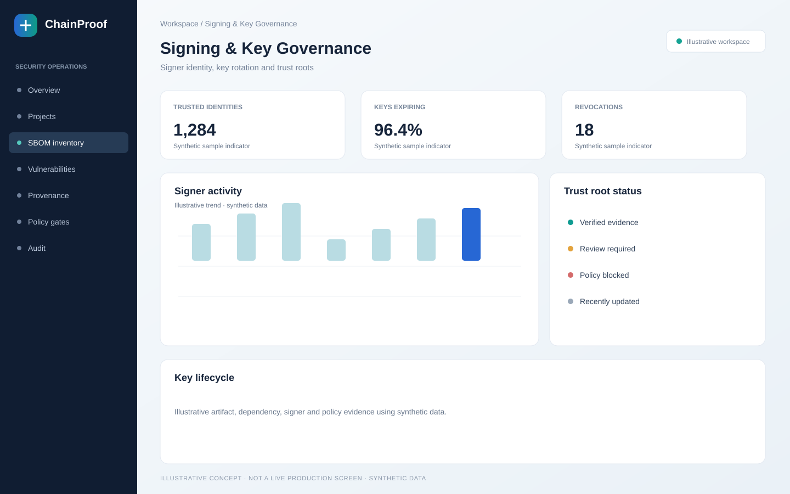

### 11. Incident Evidence Timeline
Forensic event history linking security events, artifacts and accountable actors.

### 12. Audit & Compliance Overview
Evidence coverage, mapped controls, audit history and review findings.

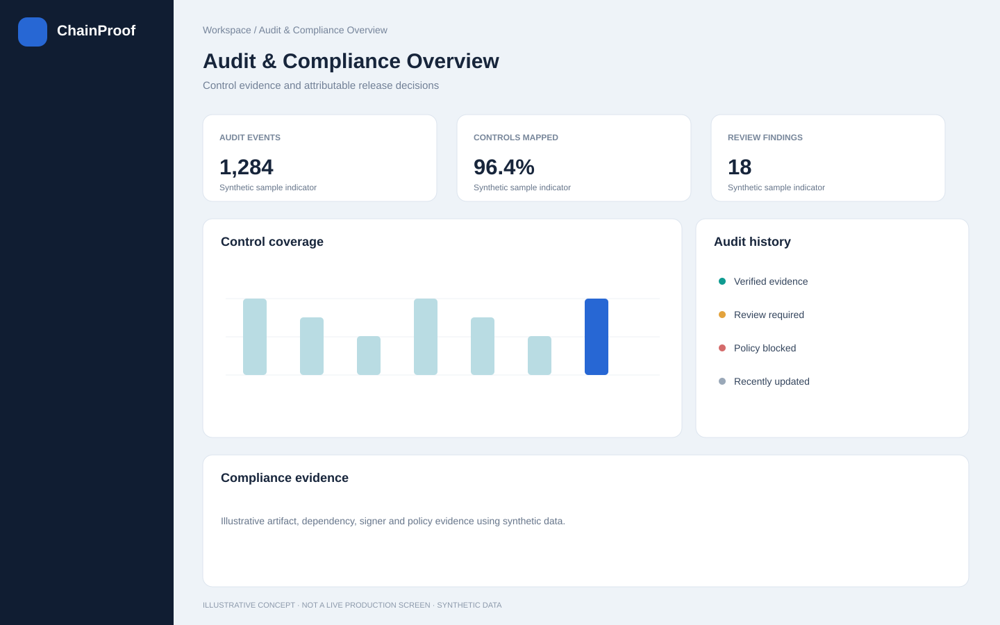

## 9. Roadmap

1. Complete tenant-scoped project and repository registry.
2. Harden webhook authentication, replay protection and idempotency.
3. Complete bounded SBOM ingestion and vulnerability correlation.
4. Verify signed provenance and artifact digests.
5. Introduce versioned policy packs, VEX workflows and release evidence.
6. Add security integration tests, operational metrics and incident runbooks.

## 10. Contribution and license

See [CONTRIBUTING.md](CONTRIBUTING.md) and [SECURITY.md](SECURITY.md). License status is governed by the repository's license file; absent a license, all rights are reserved.
