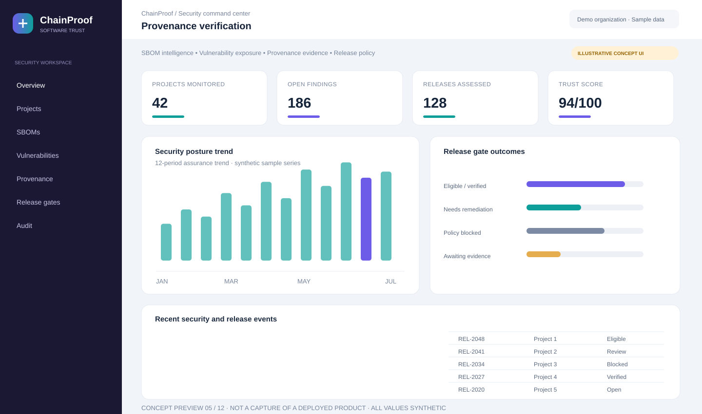

# ChainProof

**Enterprise Software Supply Chain Security & Trust Intelligence Platform**

> Make software releases explainable and verifiable through SBOM, vulnerability and provenance evidence.

## 1. Product overview

ChainProof helps engineering and security teams understand, verify, govern and improve the integrity of the software they ship. It connects software inventory, vulnerability intelligence, build provenance, policy decisions and release evidence in an auditable workflow.

**Cryptographic verification and deterministic policy enforcement are authoritative. AI may explain evidence and recommend actions, but must never substitute for verification or release policy.**

## 2. Current implementation

- Tenant-scoped project registry and GitHub App repository linking foundation.
- CycloneDX and SPDX SBOM ingestion with bounded parsing, normalization and deduplication.
- OSV vulnerability intelligence and remediation metadata.
- Release trust scoring and deterministic eligibility gates.
- DSSE-wrapped in-toto provenance verification using operator-configured Ed25519 trust keys.
- Audit events and evidence-oriented release governance.

**Verification boundary:** the current ChainProof provenance profile is project-specific. It is not a full Sigstore bundle verifier and does not claim SLSA certification. Trust depends on operator-configured public-key roots; vulnerability findings are time-sensitive snapshots.

## 3. Technology stack

React 19 · TypeScript · Vite · Node.js · Express 5 · MongoDB · Mongoose · Zod · pnpm 10.12.1 · Turborepo.

## 4. Architecture

- `apps/web`: React security and project workspaces.
- `apps/api`: Express API, tenant-scoped domains, SBOM and release services.
- `packages`: shared tooling/contracts where present.
- `docs`: architecture, threat model, security and integration notes.
- Provider integrations use bounded inputs, explicit trust configuration and auditable decisions.

## 5. Local development

Prerequisites: Node.js 22+, pnpm 10.12.1 (Corepack recommended), Docker and MongoDB replica-set support for transaction-backed paths.

```bash
corepack enable
pnpm install
cp .env.example .env
# Configure MONGODB_URI, auth secrets and CHAINPROOF_ATTESTATION_TRUSTED_KEYS.
pnpm dev
```

Never store private signing keys in ChainProof. Configure only trusted public keys through the deployment secret/configuration system. Web and API commonly use ports 5173 and 4000 respectively.

Quality checks:

```bash
pnpm typecheck
pnpm build
pnpm format:check
```

Run the package-specific test scripts documented in each workspace.

## 6. Security controls

- Tenant scope and authorization are enforced server-side.
- SBOMs and provider responses are treated as untrusted input; size and item counts are bounded.
- Repository content is not executed by the API.
- Release trust gates fail closed for incomplete or invalid provenance.
- Public-key trust roots are operator controlled; private keys remain outside the application.
- Audit metadata should not retain secrets or unnecessary source payloads.
- Use synthetic data for demos; perform threat modelling, penetration testing and restore drills before production.

## 7. Illustrative dashboard gallery

These 12 views are **illustrative SVG dashboard concepts**, not screenshots captured from a running deployment. They contain synthetic sample data and do not prove that every depicted module is implemented. They are arranged in a single vertical column for full-width inspection.

### 01. Software supply-chain command center

Operations overview for registered projects, SBOM coverage, vulnerable components, blocked releases and recent trust decisions. All metrics are synthetic.


### 02. SBOM inventory

Component inventory showing package coordinates, versions, licenses, dependency relationships and SBOM provenance. All records are synthetic.


### 03. Vulnerability intelligence

Vulnerability intelligence workspace showing advisory severity, exploitability context, affected versions and remediation state. All findings are synthetic snapshots.


### 04. Release trust passport

Release trust passport summarizing artifact identity, provenance status, policy outcomes and evidence completeness. All releases are illustrative.


### 05. Provenance verification

Provenance verification view for signed attestations, subject digests, trusted signer identity and verification results. All evidence is synthetic.



### 06. Policy & release gates

Release policy workspace showing deterministic controls, evaluation outcomes, blocking reasons and exception governance. All policies are examples.


### 07. Dependency risk graph

Dependency risk graph concept connecting direct and transitive packages to vulnerable paths and critical downstream services. All nodes are illustrative.


### 08. Remediation workspace

Remediation workspace for vulnerability ownership, fix availability, due dates, risk acceptance and verified closure. All tickets are synthetic.


### 09. GitHub integration health

GitHub integration health view for linked repositories, webhook delivery, permission scope and synchronization status. All values are synthetic.


### 10. Audit & evidence trail

Audit evidence timeline showing attributable policy decisions, trust evaluations, provenance checks and administrative changes. All events are synthetic.


### 11. Supplier & component risk

Supplier and component risk view linking package maintainers, origin signals, dependency exposure and evidence confidence. All entities are illustrative.


### 12. Security posture analytics

Security posture analytics summarizing vulnerability trends, SBOM freshness, release-gate outcomes and remediation performance. All charts use synthetic values.


## 8. Engineering delivery

GitHub Actions includes CI, CodeQL, secret scanning and dependency auditing. The latest feature-branch audit against the committed frozen pnpm lockfile reports no known vulnerabilities. Continue monitoring new advisories; remaining priorities include tenant authorization integration tests, end-to-end accessibility checks, immutable action pinning, observability and disaster-recovery exercises.

## 9. Documentation

- [Threat model](docs/security/THREAT-MODEL.md)
- [Release attestation verification](docs/security/RELEASE-ATTESTATION-VERIFICATION.md)
- [SBOM ingestion](docs/architecture/SBOM-INGESTION.md)
- [Vulnerability intelligence](docs/architecture/VULNERABILITY-INTELLIGENCE.md)

## 10. Roadmap

1. Expand provenance conformance and trust-root lifecycle management.
2. Add continuous SBOM rescans, exploitability enrichment and remediation SLAs.
3. Keep the committed frozen pnpm lockfile current and monitor newly disclosed advisories.
4. Expand cross-tenant authorization, route integration and browser tests.
5. Add signed audit export, operational metrics, backup/restore validation and production runbooks.

## 11. Responsible claims

ChainProof provides software supply-chain security decision support. A trust score is an explainable indicator, not a certification. An SBOM is an inventory, not proof that a build is safe. Validate all policy, provenance and vulnerability evidence in the release context.
