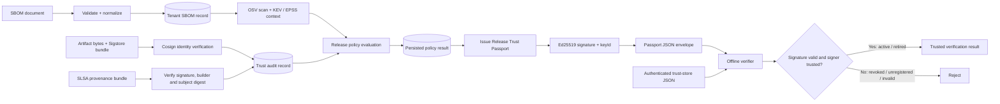
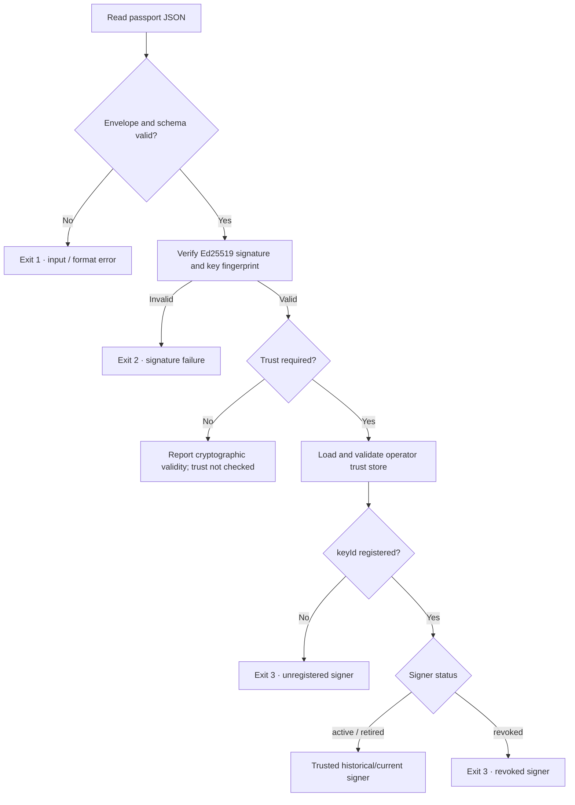

# ChainProof System Architecture

This page describes the **implemented MVP architecture** and its trust boundaries. Planned components are labelled explicitly and are not represented as shipped functionality.

## 1. Runtime architecture

```mermaid
flowchart TB
    subgraph Client["User-facing client"]
        Browser["Security analyst / developer / auditor"]
        Web["React + TypeScript dashboard"]
        Browser --> Web
    end

    subgraph API["Node.js + Express API (modular monolith)"]
        Edge["HTTPS boundary · CORS · Helmet · rate limits"]
        Auth["JWT authentication · role authorization"]
        Validate["Zod request validation"]
        SBOM["SBOM intake · bounded enqueue"]\n        SBOMWorker["Background worker · official schema validation · normalization"]
        Vuln["Vulnerability intelligence · scan snapshots"]
        Verify["Artifact trust verification · Cosign / SLSA"]
        Policy["Deterministic release-policy evaluation"]
        Passport["Signed Release Trust Passport · Ed25519"]
        Signers["Tenant-scoped signer registry"]
        Edge --> Auth --> Validate
        Validate --> SBOM\n        SBOM --> SBOMWorker
        Validate --> Vuln
        Validate --> Verify
        Validate --> Policy
        Validate --> Passport
        Passport <--> Signers
    end

    DB[("MongoDB · tenant-scoped records")]
    OSV["OSV vulnerability API"]
    Context["CISA KEV / FIRST EPSS enrichment"]
    Sigstore["Sigstore / Fulcio / Rekor verification material"]

    Web -->|"HTTPS · JSON · Bearer JWT"| Edge
    SBOMWorker --> DB
    Vuln <--> DB
    Vuln -->|"package URL batch lookup"| OSV
    Vuln -->|"CVE alias enrichment"| Context
    Verify -->|"signature / certificate verification"| Sigstore
    Verify --> DB
    Policy --> DB
    Passport --> DB
    Signers --> DB
```

### Component responsibilities

| Component | Responsibility |
|---|---|
| Web dashboard | Presents inventory, vulnerability, verification, policy and passport evidence |
| API security boundary | Authenticates requests, applies role checks, validates input and enforces request limits |
| SBOM intake + worker | API enforces a 2 MiB bound and durably queues raw JSON; the background worker applies official CycloneDX/SPDX schemas, complexity checks, normalization and tenant-scoped persistence. Raw payloads are deleted at terminal state |
| Vulnerability intelligence | Queries OSV and enriches CVE aliases with KEV/EPSS context; stores scan snapshots |
| Artifact trust verification | Verifies supplied artifact bytes against configured Cosign identity and SLSA builder policies |
| Release policy | Evaluates persisted evidence using versioned deterministic rules and stores pass/warn/block outcomes |
| Passport service | Binds evidence and policy evaluation into an Ed25519-signed portable envelope |
| Signer registry | Tracks tenant-scoped active, retired and revoked public-key fingerprints |

## 2. Release evidence and passport lifecycle



**Important distinction:** a valid Ed25519 signature proves that the passport payload has not been altered and matches the embedded public key. It does not, by itself, prove who controls that key. Publisher trust requires a separately authenticated trust store or trusted signer inventory.

## 3. Offline verification trust decisions

The CLI accepts a passport file and, optionally, an operator-managed trust-store file:

```bash
npm run passport:verify -- --file ./release-passport.json --trust-store ./release-passport-trust-store.json --require-trusted
```



| Signer state | Offline trust decision |
|---|---|
| active | Accept as trusted |
| retired | Accept for historical verification |
| revoked | Reject |
| Not registered | Reject when --require-trusted is enabled |

The trust store must be obtained through an authenticated channel independent of the passport source. Do not download the passport and its trust store from the same untrusted location and treat that as independent trust.

### Exit codes

| Code | Meaning |
|---:|---|
| 0 | Signature valid; trust requirement satisfied when requested |
| 1 | Invalid arguments, unreadable input, malformed JSON or unsupported format |
| 2 | Invalid signature or key fingerprint mismatch |
| 3 | Required signer trust missing, revoked or otherwise unacceptable |

## 4. Trust boundaries and operational rules

1. **Browser → API:** use TLS; API derives tenant identity from the authenticated principal, not caller-supplied tenant IDs. Async SBOM intake is capped at 2 MiB; pending raw JSON is temporarily stored in MongoDB and removed on completion or failure.
2. **API → MongoDB:** keep tenant-scoped queries and least-privilege database credentials.
3. **API → external intelligence providers:** bound payloads, timeouts and retries; treat provider data as untrusted input.
4. **Artifact/provenance verification:** bind verification to exact artifact bytes and explicit server-side signer/builder identity policies.
5. **Passport signing:** keep the Ed25519 private key in deployment secret management; never accept private-key material from API clients.
6. **Offline trust:** distribute trust-store fingerprints through a separate authenticated channel; preserve retired keys for historical checks and reject revoked keys.

## 5. Current scope versus planned evolution

The current runtime is a TypeScript modular monolith with MongoDB persistence. The current runtime includes a MongoDB-backed durable SBOM queue and an in-process worker with atomic leases and bounded retries. Dedicated independently deployed worker processes, Redis coordination and object storage for large evidence remain future evolution options.

## 6. Useful local commands

Run the API and web development workflow:

```bash
npm install
npm run dev
npm run dev:web
```

Run validation and builds before opening a pull request:

```bash
npm test
npm run typecheck
npm run build
```

Verify a passport locally:

```bash
npm run passport:verify -- --file ./release-passport.json
```

Use --trust-store with --require-trusted when publisher trust must be enforced.
